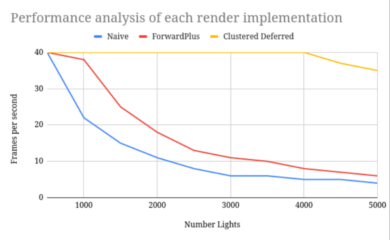

WebGL Forward+ and Clustered Deferred Shading
=============================================

**University of Pennsylvania, CIS 565: GPU Programming and Architecture, Project 4**

* Andrea Gonzalez Varela
* Tested on: (TODO) **Google Chrome for Testing v157.0.8102.0** on
  Linux, 13th Gen Intel(R) Core(TM) i9-13980HX @ 5.6GHz 128GB, RTX 2000 Ada Generation 8GB (Personal)

### Live Demo

### Demo Video/GIF

#### Naive

#### Forward plus

#### Clustered deferred

### Overview

This project implements 3 versions of a real-time lighting pipeline using WebGPU.

The first is the naive renderer, which evaluates every active light for every fragment. The second is forward plus, which divides the camera frustrum into a 16x16x16 grid of cluters, with a compute shader determining which lights overlap each cluster so that a fragment shader can evaluate only the relevant lights for each point. Finally, the clustered deferred implementation first does a geometrt pass that stores albedo and world-space normals in a G-buffer and writes scene depth, then does a fullscreen lighting pass that uses this data to reconstruct the view-space and evaluates the lights assigned to each pixel's cluster.

### Performance Analysis

| Number Lights | Naive (ms) | ForwardPlus (ms) | Clustered Deferred (ms) |
| ------------- | ---------- | ----------------- | ------------------------ |
| 500           | 25         | 25                | 25                       |
| 1000          | 45.45      | 26.32             | 25.00                    |
| 1500          | 66.67      | 40.00             | 25.00                    |
| 2000          | 90.91      | 55.56             | 25.00                    |
| 2500          | 125.00     | 76.92             | 25.00                    |
| 3000          | 166.67     | 90.91             | 25.00                    |
| 3500          | 166.67     | 100.00            | 25.00                    |
| 4000          | 200.00     | 125.00            | 25.00                    |
| 4500          | 200.00     | 142.86            | 27.03                    |
| 5000          | 250.00     | 166.67            | 28.57                    |

At 500 lights, all three renderes perform similarly at approximatly 25ms per frame. This suggests that fixed rendering costs and limits dominate at small light counts.

As the number of lights increase, the naive renderer's frame time grows most rapidly out of the three. This growth indicates that its lighting workload scales approximately with the produce of the number of fragments and lights.

While the frame time of the forward plus implementation grows more slowly, it still underperforms  the clustered deferred implementation. This indicates that the cost of testing every light against every cluster, and the cost of preprocessing the lighting list of each cluster.

Clustered deferred performs the best by a wide margin. This indicates that optimizations are succesful at reducing the processing required especially at higher light counts, especially because the lighting is determined in a fullscreen pass after visibility is resolved, which reduces the number of iterations required for geometry hidden behind other surfaces. However the implementation does require additional memory bandwith for albedo, normal and depth textures, so the results observed might be different if run on different hardware.

### Credits

- [Vite](https://vitejs.dev/)
- [loaders.gl](https://loaders.gl/)
- [dat.GUI](https://github.com/dataarts/dat.gui)
- [stats.js](https://github.com/mrdoob/stats.js)
- [wgpu-matrix](https://github.com/greggman/wgpu-matrix)
